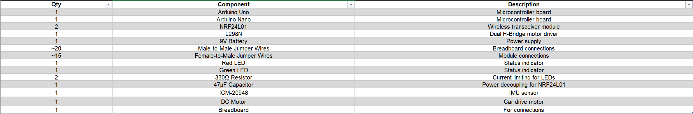
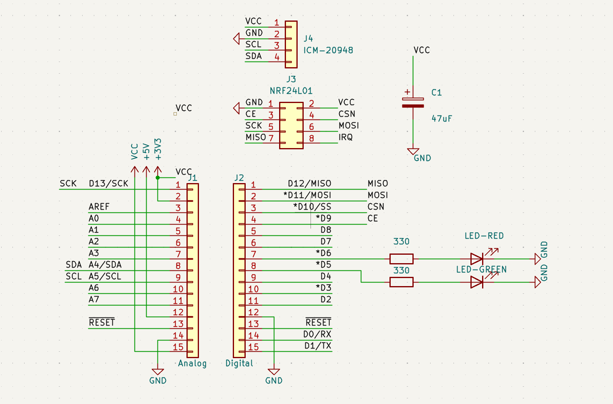
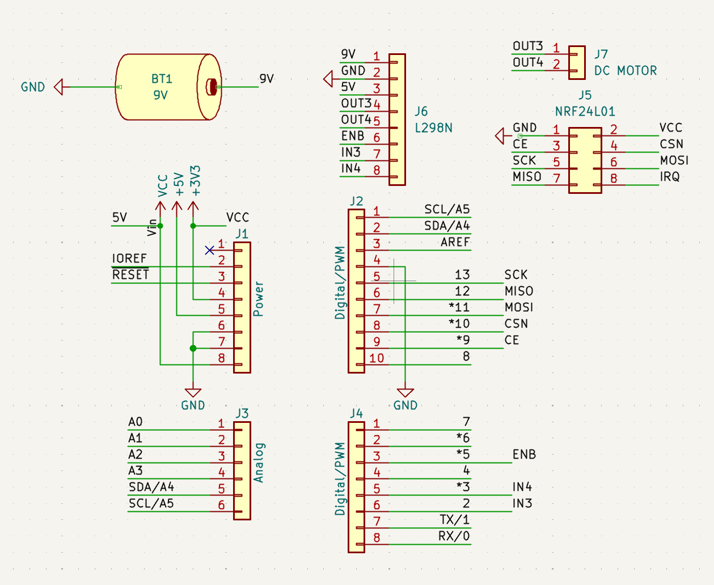

# Gesture-Controlled RC Car

A wireless RC vehicle controlled via hand gestures, mapping IMU tilt data to motor control commands over RF.

## Hardware Demo
*Live demonstration of the gesture-controlled car in action, successfully translating hand tilt into physical movement:*  

## Hardware & Tech Stack
- **Microcontrollers:** 1x Arduino Nano (Transmitter/Glove), 1x Arduino Uno (Receiver/Car)
- **Sensors & Modules:** ICM-20948 IMU, nRF24L01 (Wireless Transceivers), L298N (Motor Driver)
- **Language:** Arduino C++

## Bill of Materials (BOM)
*Complete list of hardware components used in this project:*  

## Hardware Architecture & Schematics
The system is divided into two distinct units: the gesture-sensing transmitter and the motor-driven receiver.

**1. Transmitter (Glove) Schematic**  
*Wiring diagram for the Arduino Nano, ICM-20948 IMU (I2C), nRF24L01 (SPI), and status LEDs:*  

**2. Receiver (Car) Schematic**  
*Wiring diagram for the Arduino Uno, nRF24L01 (SPI), and L298N motor driver connected to the DC motors and 9V power supply:*  

## Key Features
- **Dynamic Calibration & Filtering:** The transmitter calibrates the IMU on startup and applies a filter to smooth the accelerometer data.
- **Threshold-Based Commands:** Uses specific activation/deactivation thresholds to prevent jitter and ensure stable directional commands.
- **Failsafe Mechanism:** The receiver implements a 500ms timeout system; if the radio signal is lost or interrupted, the motors stop automatically to prevent accidents.
- **H-Bridge Control:** The L298N motor driver receives PWM signals to efficiently manage motor speed and direction.

## Setup & Run
1. Assemble the **Transmitter** and **Receiver** hardware according to the schematics provided above.
2. Upload `emitter_glove.ino` to the Arduino Nano. **Note:** Keep the IMU completely still during startup for accurate reference calibration.
3. Upload `receiver_car.ino` to the Arduino Uno.
4. Ensure both nRF24L01 modules have adequate power (the 47µF decoupling capacitor on the transmitter is crucial for stable RF communication).

## AI Usage
Artificial Intelligence tools were utilized during the development of this project to enhance workflow efficiency:
- **Debugging & Troubleshooting:** Assisted in identifying logic errors, optimizing the IMU data filtering, and refining the RF communication code.
- **Formatting & Documentation:** Used to structure the GitHub repository and organize the project presentation.
